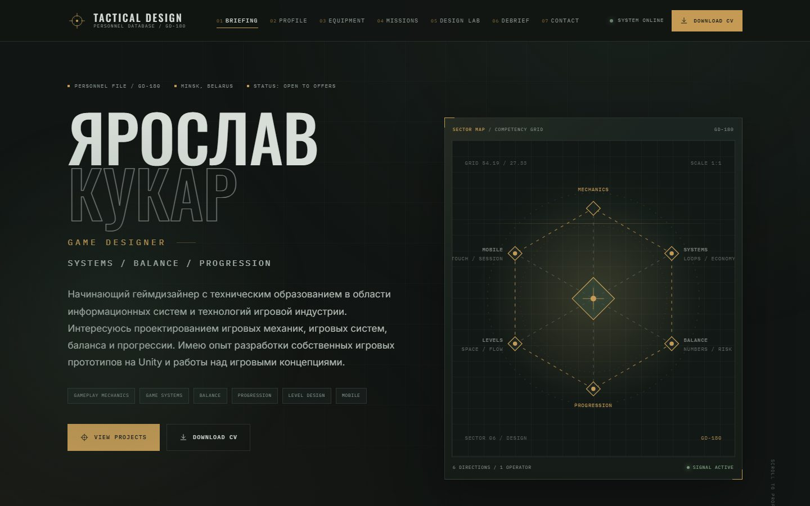
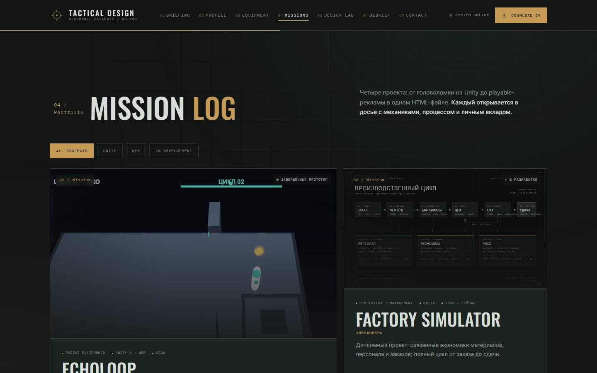
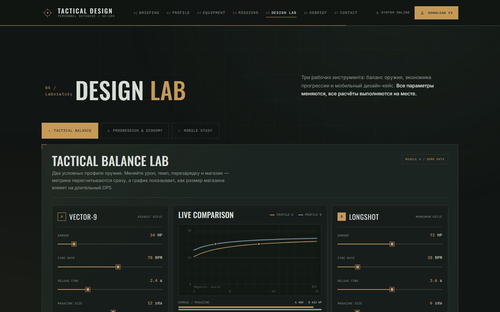
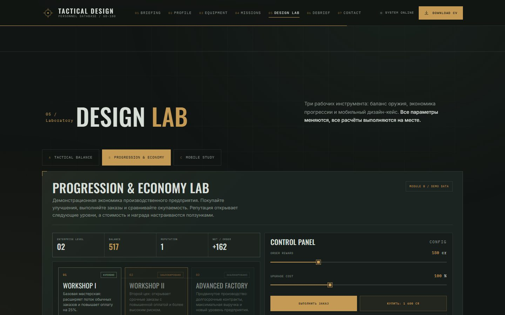
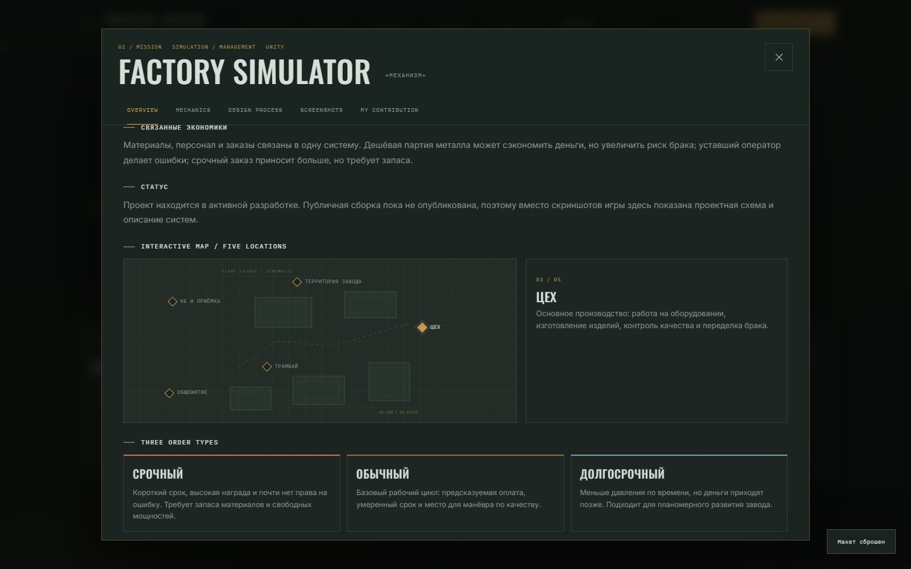
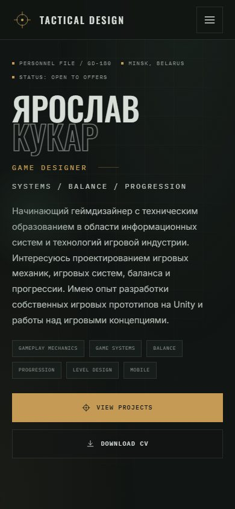

# TACTICAL DESIGN — интерактивное резюме Game Designer

Одностраничное портфолио Ярослава Кукара, начинающего геймдизайнера: тактическая HUD-эстетика, реальные проекты и работающие интерактивные модели баланса, экономики и мобильного управления.

**Live:** [kerarty.github.io/cv-octopus](https://kerarty.github.io/cv-octopus/)

[](https://kerarty.github.io/cv-octopus/)

## О проекте

Это не статичная страница с текстом, а небольшой интерактивный инструмент. Все кнопки, вкладки, фильтры, слайдеры и расчёты работают по-настоящему: значения пересчитываются по формулам, состояние лабораторий меняется, проектные окна открываются с полным контентом.

Сайт собран на чистом HTML, CSS и JavaScript с Vite. Без React, без бэкенда и без внешних UI-библиотек. Шрифты хранятся локально, изображения и демо — в репозитории.

## Скриншоты

| Миссии и проекты | Баланс-лаборатория |
| --- | --- |
|  |  |

| Экономика прогрессии | Проектное окно «Механизма» |
| --- | --- |
|  |  |

<p align="center">
  
</p>

## Что внутри

- **Initialization** — короткая загрузочная последовательность с пропуском и поддержкой `prefers-reduced-motion`.
- **Briefing** — главный экран с ключевыми фактами и быстрым переходом к разделам.
- **Operator Profile** — профиль, образование, языки, интересы и подход к дизайну.
- **Equipment** — инструменты и навыки, сгруппированные по направлениям.
- **Mission Log** — четыре проекта с фильтрами по платформе и статусу.
- **Project modal** — пять вкладок: Overview, Mechanics, Design Process, Screenshots, My Contribution. Для «Механизма» — интерактивная карта пяти локаций и три типа заказов.
- **Design Lab** — три рабочие модели:
  - **A / Balance** — два оружия, слайдеры характеристик, расчёт DPS, TTK, боезапаса и сравнительный SVG-график;
  - **B / Economy** — заказы, репутация, дерево улучшений, стоимость и окупаемость;
  - **C / Mobile Study** — макет телефона с тач-управлением, стрельбой, ADS, переключением раскладки и расходом патронов.
- **Debrief** — интерактивный таймлайн этапов работы.
- **Contact** — копирование контактов и скачивание PDF-резюме.
- **Runner demo** — реальный playable-билд, встроенный в сайт: тап — прыжок, 3 HP, монеты, финиш на дистанции 6200.

## Стек

- HTML5, CSS3 (custom properties, grid, container-less responsive layout)
- Vanilla JavaScript (ES modules)
- Vite 7
- Локальные WOFF2-шрифты: Oswald, Inter, IBM Plex Mono
- GitHub Pages

## Запуск

Нужен Node.js 22+.

```bash
npm install
npm run dev
```

Сборка и локальный предпросмотр:

```bash
npm run build
npm run preview
```

Деплой на GitHub Pages (ветка `gh-pages`):

```bash
npm run deploy
```

## Структура

```text
src/
  assets/fonts/        локальные шрифты
  components/          навигация, модальные окна, лаборатории, таймлайн
  data/                профиль, навыки, проекты
  lib/                 DOM- и SVG-хелперы
  sections/            секции страницы
  styles/              переменные, база, сетка, компоненты, адаптив
  main.js              сборка страницы и инициализация
public/
  demo/runner/         реальный playable-билд Runner
  docs/                PDF-резюме
  images/projects/     скриншоты и проектная схема
docs/screenshots/      скриншоты для README
```

## Источники и честность материалов

- Профиль, контакты и образование взяты из проверенного CV. Образование: **БГУИР, «Информационные системы и технологии в игровой индустрии», бакалавр / инженер-программист, 2023–2027, 4-й курс**.
- **ECHOLOOP** и **MOB RUSH!** — реальные проекты; скриншоты взяты из их репозиториев.
- **RUNNER** — реальный собранный билд из репозитория, а не макет. Демо лежит в `public/demo/runner/`.
- **«Механизм» / Factory Simulator** — дипломный проект в разработке, публичной сборки нет. Поэтому вместо выдуманного скриншота используется собственная проектная схема с явной подписью «ПРОЕКТНАЯ СХЕМА / НЕ СКРИНШОТ ИГРЫ».
- В портфолио нет придуманных достижений, метрик или результатов, которых не было в исходных материалах.

## Проверка

Сайт проверен автоматизированными сценариями в Edge через Puppeteer: **46/46 проверок** на разрешениях 1440×900, 820×1180 и 390×844. Проверялись отсутствие горизонтального скролла и ошибок консоли, загрузка изображений, фильтры, модальные вкладки, баланс- и экономика-лаборатории, мобильное исследование, таймлайн, копирование контактов, мобильное меню, карта завода и canvas Runner.

## Контакты

- **Ярослав Кукар** — Game Designer
- Email: [kukar.yar@gmail.com](mailto:kukar.yar@gmail.com)
- Телефон: [+375 44 783-84-89](tel:+375447838489)
- GitHub: [github.com/Kerarty](https://github.com/Kerarty)
- Минск, Беларусь
